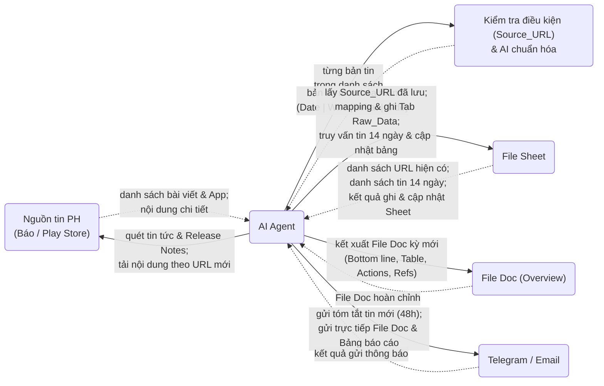

# TÀI LIỆU THIẾT KẾ HỆ THỐNG AI AGENT THEO DÕI ĐỐI THỦ (THỊ TRƯỜNG PHILIPPINES)

## 1. Cấu trúc Form File Google Sheets (`PH_RideHailing_Competitor_Tracking`)
- **Tab 1 (`Raw_Data` - Cập nhật 2 ngày/lần):** `Timestamp_ISO` | `Date` | `Who` | `What` | `Side` | `Source_Name` | `Source_Title` | `Source_URL`
- **Tab 2 (`Current_Report_Table` - Cập nhật 2 tuần/lần):** `Date` | `Who` | `What` | `Side` | `Ref` (`[1], [2]...`) | `Full_Reference_Citation`
- **Tab 3 (`BiWeekly_Overview_Archive` - Lưu trữ lịch sử 2 tuần/lần):** `Report_Date` | `Report_Header` | `Bottom_Line` | `Feature_Launches_Count` | `What_Id_Like_Us_To_Act_On` | `References_Block`

## 2. Cấu trúc Form File Google Docs (Báo cáo Overview 2 tuần/lần)
1. **Điểm cốt lõi (Bottom line):** Các gạch đầu dòng tóm tắt nhanh xu hướng chiến lược và thay đổi lớn nhất trong 14 ngày qua (gắn kèm số trích dẫn `[1], [2]...`). Nếu không có tin mới, ghi nhận trạng thái thị trường ổn định, không có biến động lớn.
2. **Tính năng và sản phẩm mới ra mắt (Feature and product launches):** Bảng liệt kê theo đúng cấu trúc `Date | Who | What | Side | Ref`. Nếu không có tin mới, bảng ghi nhận dòng thông báo trạng thái toàn thị trường.
3. **Đề xuất hành động cần thực hiện (What I'd like us to act on):** Các nhận xét và hướng hành động cụ thể cho đội ngũ viết theo từng ý rõ ràng, không kèm mức độ ưu tiên P0/P1.
4. **Tài liệu tham khảo (References):** Danh sách nguồn đầy đủ kèm đường link gốc tương ứng với các số `[1], [2]...`.

> **Quy tắc khi không có tin mới (No-update policy):** Hệ thống luôn gửi báo cáo xác nhận trạng thái thị trường không có biến động ở cả 2 kênh Telegram và Email, đồng thời ghi log lưu trữ vào Google Sheets để đảm bảo tính liên tục của dữ liệu theo dõi.

## 3. Ma trận Nguồn tin Đa tầng (Multi-tier Official Sources Matrix)
1. **Tier 1 - Cơ quan Quản lý Vận tải:**
   - **LTFRB** (Land Transportation Franchising and Regulatory Board) & **DOTr** (Department of Transportation): Theo dõi chính sách giá cước (fare matrix), trần phụ phí (surge pricing cap), quy chế thí điểm xe máy công nghệ (motorcycle taxi pilot program), hạn ngạch tài xế (rider caps) và các quyết định xử phạt/cấp phép TNVS.
2. **Tier 2 - Báo chí Kinh doanh & Truyền thông Chính thống Philippines:**
   - **BusinessWorld (`bworldonline.com`)**: Phân tích tài chính, chính sách hoa hồng tài xế, chiến lược siêu ứng dụng.
   - **Philstar (`philstar.com`)**: Diễn biến pháp lý, tòa án, thông cáo bộ ngành và biến động thị trường.
   - **Rappler (`rappler.com`)**: Điều tra độc lập về giá cước, chính sách cạnh tranh và phản hồi cộng đồng tài xế.
   - **GMA News (`gmanetwork.com`) & Inquirer (`inquirer.net`)**: Hướng dẫn tiêu dùng, an toàn hành khách, tin tức vận tải đô thị.
3. **Tier 3 - Cổng thông tin & Thông cáo Báo chí Chính thức Đối thủ:**
   - **Grab Philippines**: Trang chính thức (`grab.com/ph/`), Press Centre (`grab.com/ph/press/`), quan hệ đối tác Grab-MoveIt (`grab.com/ph/press/others/`), cổng tuyển dụng tài xế và Grab Help Center.
   - **inDrive Philippines**: Trang chính thức (`indrive.com/en-ph/`), cơ chế "Fair Services" trả giá tự do, city rides và tuyển dụng tài xế.
   - **JoyRide Philippines**: Cổng thông tin chính thức (`joyride.com.ph`), dịch vụ MC Taxi, JoyRide Car, trạm Onboarding tài xế.
   - **Angkas**: Trang chính thức (`angkas.com`), an toàn biker, chính sách hoa hồng và mở rộng vùng phủ.
   - **Move It**: Cổng thông tin chính thức (`moveit.com.ph`), thông báo hợp tác cùng Grab.
4. **Tier 4 - Kho Ứng dụng Di động (Changelog & Release Notes):**
   - **Google Play Store PH (gl='ph')**: Theo dõi trực tiếp bản cập nhật của các Driver App & Passenger App.
   - **Apple App Store PH (iOS Lookup API)**: Theo dõi phiên bản và release notes của Grab PH (`647268330`), Move It (`1481198245`), inDrive (`780125801`).

## 4. Sơ đồ Data Flow (DFD)

